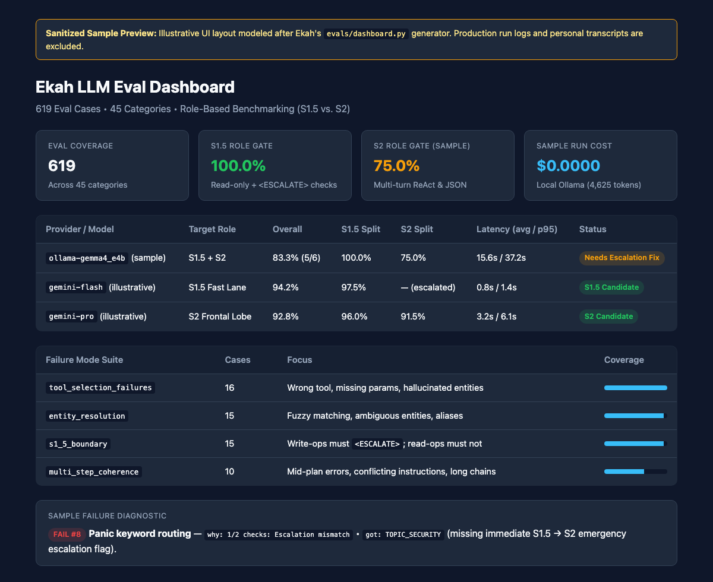

# Ekah — 0-to-1 Agentic System Architecture, Guardrails & Evals Showcase

> *Note: LLMs were used to help draft and structure this documentation from the underlying system design.*

> **Executive Summary:** **Ekah** is a 0-to-1, multi-modal agentic assistant built to turn fragmented, multi-step workflows (smart home, email, calendar, tasks, proactive routines) into low-latency conversational experiences across voice, messaging, and tablet surfaces. Rather than wrapping a single LLM prompt, Ekah implements **latency-tiered cognitive routing** (sub-millisecond rules → fast one-shot `S1.5` → multi-turn ReAct `S2`), a **policy-driven authority gate** (`TrustTier × ToolSensitivity` with explicit human-in-the-loop confirmation), **noise-filtering & proactive scheduling**, and a **619-case, 45-category LLM eval harness** with parameter sweeps and cost/latency tracking.
>
> *Note: This repository is a sanitized, documentation-only architecture and product case study. Production source code, credentials, and user data are intentionally excluded.*

---

## Contents

| Document | Summary |
| :--- | :--- |
| **[README.md](./README.md)** | Product & architecture case study: problem framing, 0-to-1 system design, key PM tradeoffs, and transferability to agentic workflows. |
| **[docs/architecture.md](./docs/architecture.md)** | Deep dive into the 3-module pipeline (`Sensory Router → Synth-Brain → Auditory Router`), cognitive tiering (`Tier 0` → `S1.5` → `S2`), NLU side-channels, and proactive/memory loops. |
| **[docs/trust-and-guardrails.md](./docs/trust-and-guardrails.md)** | Deep dive into `ToolCallGate` (`TrustTier × ToolSensitivity` matrix), `NEEDS_CONFIRMATION` approval flows, identity/liveness checks, and graceful degradation. |
| **[docs/evals-framework.md](./docs/evals-framework.md)** | Deep dive into the 619-case / 45-category eval suite, role-based candidate testing (`S1.5` vs. `S2`), multi-provider benchmarking, and parameter sweeps. |

---

## 1. The 0-to-1 Product Problem

Most early agentic products fail in production for three predictable reasons:
1. **Latency & Cost Bloat:** Routing every user utterance through a frontier reasoning model makes simple status checks feel sluggish and burns token budgets.
2. **Unsafe Autonomy:** Giving an LLM unrestricted write access to external APIs or real-world state creates unacceptable blast radius when the model misinterprets intent or context.
3. **Evaluation Blindness:** Shipping prompt changes without regression suites across routing, tool-calling, escalation, and persona quality leads to silent regressions.

**Ekah's North Star:** Deliver minimal-latency, trustworthy, multi-surface agentic execution where deterministic rules handle the obvious, fast models handle read-only queries, deep reasoning handles multi-step writes, and every high-impact action passes through an explicit authority gate.

---

## 2. Core Architectural Pillars

### A. Latency-Tiered Cognitive Routing
Instead of one monolithic agent loop, Ekah routes every normalized `SensoryEvent` through progressive tiers in `gate/orchestrator.py`:

* **Tier 0 (`RuleEngine`):** Deterministic, sub-millisecond checks for hard state deltas and security rules (no LLM).
* **Tier 0.5 (`MacroMatcher` / `ha_fast_lane`):** Resident-taught automations and `<500ms` fast-lane controls with zero LLM overhead.
* **Local NLU + Gate (`ThalamicGate` → `GravityScorer`):** A lightweight local NLU classifies intent, extracts entities, and detects background side-channels in `<50ms`, while `ThalamicGate` drops noise and `GravityScorer` prioritizes what deserves LLM budget.
* **System 1.5 (`ConversationalLobe`):** Fast, one-shot model (`generate_with_tools`) restricted to **read-only** queries and concise synthesis. If a write or multi-step chain is detected, it immediately emits `ESCALATE`.
* **System 2 (`FrontalLobe`):** Multi-turn ReAct loop (`tool_call` → `observe` → `alert_user` → `defer`) with parallel tool dispatch (`asyncio.gather`) and strict per-topic step limits.

### B. Authority Matrix & Human-in-the-Loop Guardrails
Every tool call—regardless of which model proposed it—must pass through `ToolCallGate` (`authority/tool_gate.py`):
* Evaluates **`TrustTier`** (`OWNER`, `RESIDENT`, `TRUSTED_GUEST`, `GUEST`, `UNTRUSTED`) against **`ToolSensitivity`** (`READ_ONLY`, `WRITE_SAFE`, `WRITE_DESTRUCTIVE`, `EXTERNAL`, `HOME_CONTROL`, `PERSONAL_DATA`, `OWNER_ONLY`).
* Returns one of three deterministic outcomes: `ALLOWED`, `NEEDS_CONFIRMATION`, or `DENIED`.
* High-risk actions (`NEEDS_CONFIRMATION`) pause execution in `PendingApprovals` behind a **6-character approval token with a 5-minute TTL**, sending an approval prompt to the user's messaging surface before any external or destructive side effect occurs.

### C. Evals-First Quality Governance
Every new feature or model change is governed by a **619-case evaluation suite across 45 categories** (`evals/cases.yaml`, `evals/runner.py`):
* **Production-Identical Prompts:** Evals import the exact prompt builders from `synth-brain` so test results reflect production behavior.
* **Role-Based Benchmarking:** Models are tested specifically as **`S1.5` candidates** (where `S2` cases verify *escalation accuracy*) or **`S2` candidates** (scoring JSON compliance, parallel tool calling, and multi-turn stop conditions).
* **Multi-Metric Capture:** Every run tracks **latency**, **token usage**, **cost per call**, and **rubric/judge pass rate**, with parameter sweeps (`param_sweep.py`) and an HTML comparison dashboard.

---

## 3. Key Product & Engineering Tradeoffs

| Decision | Tradeoff Made | Why It Mattered |
| :--- | :--- | :--- |
| **Split `S1.5` (fast/read-only) vs. `S2` (deep/write)** | Added routing & escalation complexity | Kept common queries under ~1s while reserving expensive multi-turn reasoning for true multi-step writes. |
| **Deterministic `ToolCallGate` outside the LLM** | Rigid policy matrix vs. prompt-based safety | Prompts can be jailbroken or confused; a code-enforced `TrustTier × Sensitivity` matrix guarantees blast-radius bounds. |
| **Budget-aware deferral (`OvernightQueue`)** | Delayed non-urgent tasks vs. always-on execution | Prevents low-priority background events from exhausting API quotas, reserving capacity for real-time user intent and emergencies. |
| **Local NLU side-channel extraction** | Maintaining a local classifier alongside LLMs | Captures passive signals (intentions, expenses, commitments) in `<50ms` without polluting the primary conversational response. |

---

## 4. Relevance to Agentic Ads & Enterprise Workflows

The same 0-to-1 architectural patterns built in Ekah apply directly to **Agentic Ads Buying** and high-stakes commercial agents:
* **Safe Autonomy for Spend & Mutations:** Just as `ToolCallGate` + `NEEDS_CONFIRMATION` prevents unauthorized external actions, agentic ad platforms require tiered approval gates (e.g., auto-execute minor bid/pacing tweaks within guardrails; require explicit human confirmation for budget increases, new campaign launches, or creative swaps).
* **Fast-Lane vs. Deep Planning:** Routine reporting and pacing checks belong on a low-latency read-only tier (`S1.5`), while multi-step media planning, audience expansion, and cross-campaign optimization belong on a bounded multi-turn planner (`S2`).
* **Noise Filtering & Proactive Optimization:** `ThalamicGate` and `ProactiveWakeup` demonstrate how to surface high-signal recommendations only when user/campaign context warrants interruption—avoiding alert fatigue.
* **Model-Agnostic Eval Harness:** Swapping foundation models or tuning prompts in production requires automated regression gates across routing accuracy, tool parameter validity, and hallucination resistance.
